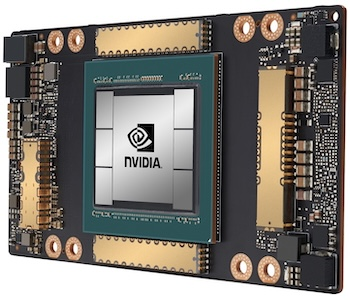
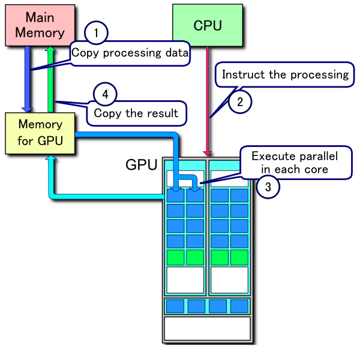
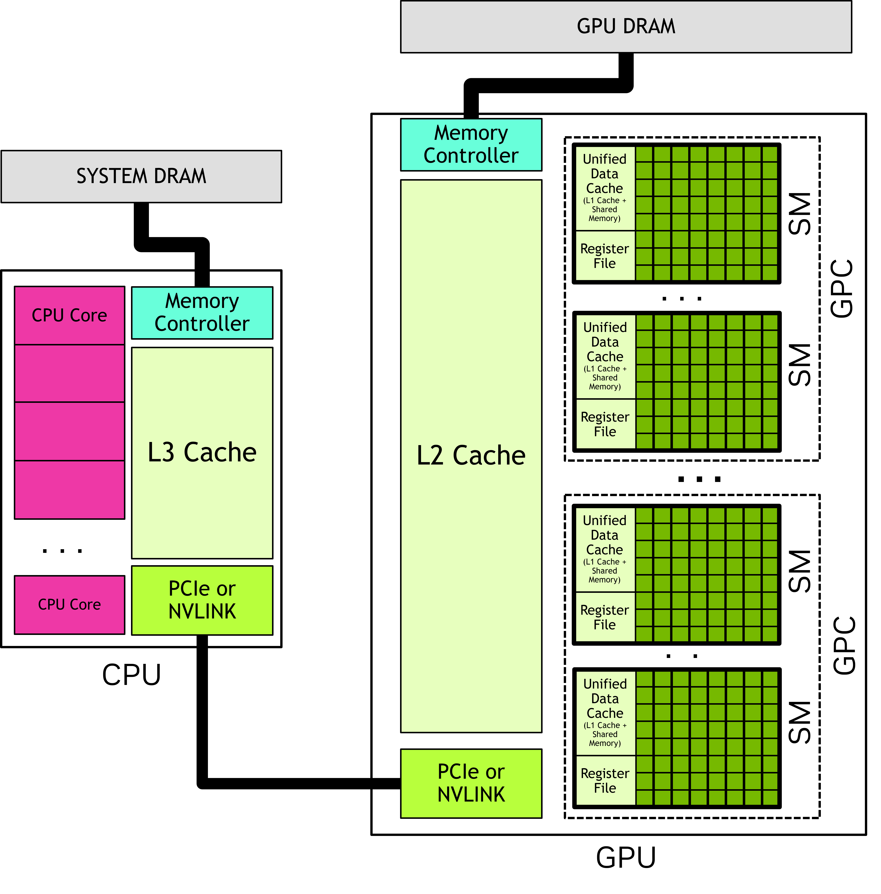
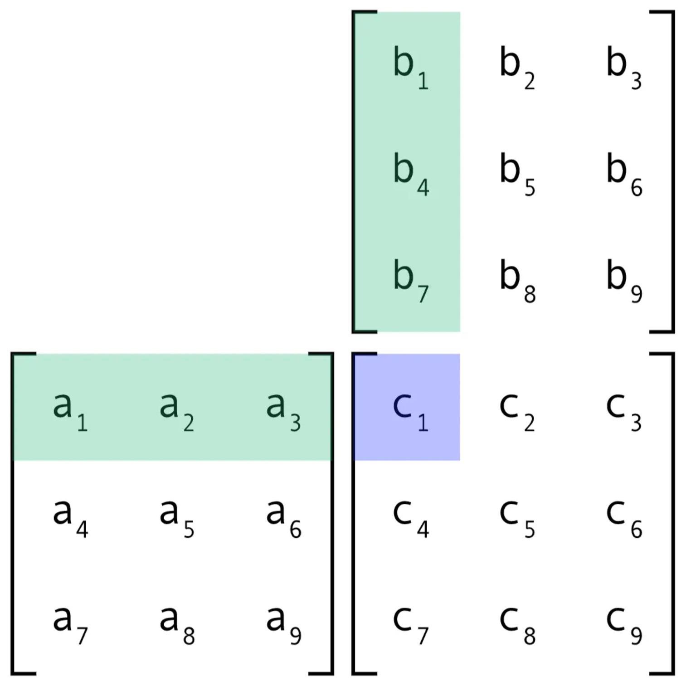
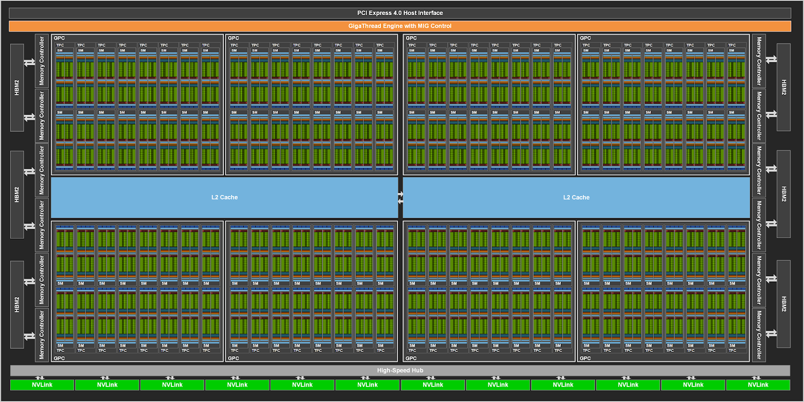
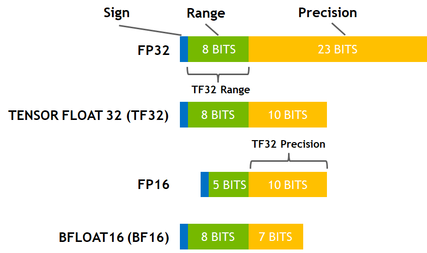
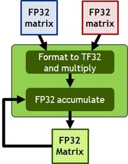
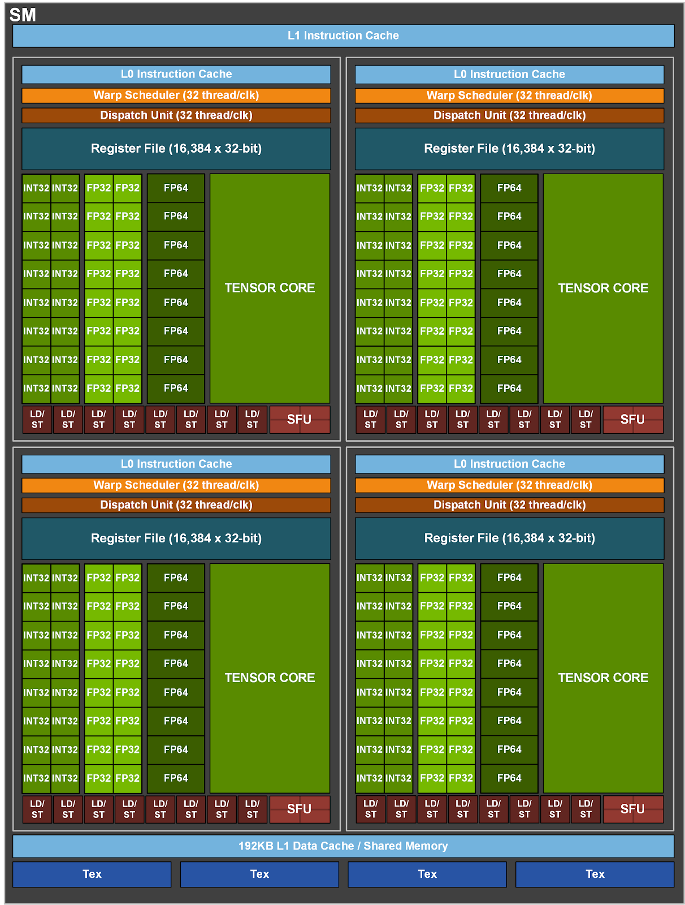

<!-- _paginate: false -->
<!-- _header: "" -->
<!-- _footer: "" -->
<!-- rumdl-disable MD013 -->

# Machine Learning on modern GPUs

Marc Carré, June 2026

---

## What is a GPU?



* "*Graphics Processing Unit*"
* "*PC extension cards to **render pixels** on your screen fast(er) — typically for video games*"
* "*A device that turns electricity into **heat**, cool **explosions** on your screen, and chatbot **gibberish** 🔥*"
* "*Hardware with ~1000x more cores than CPUs, and very good at *matrix multiplications* 🧮*"
* All of the above? ☝️

---

## CUDA Programming Model (1/4)

<div class="columns">
<div class="fs18">

A hierarchy of grids, blocks, threads:

```text
Grid
├── Block (0,0)
│   ├── Thread (0,0)
│   ├── Thread (1,0)
│   ├── Thread (2,0)
│   └── ... (up to 1024 threads per block)
├── Block (1,0)
│   ├── Thread (0,0)
│   └── ...
└── ... (potentially millions of blocks)
```

- **Thread**: The smallest unit of compute. Each thread has a unique ID (`threadIdx.x`) within its block.
- **Block**: A group of threads that can share memory and synchronise.
- **Grid**: All blocks launched by a single kernel (1D, 2D, 3D, etc.).
- Each thread computes its global index: `int idx = blockIdx.x * blockDim.x + threadIdx.x;`

  </div>
  <div>
[](https://www.digitalocean.com/community/tutorials/understanding-tensor-cores)
  </div>
</div>

---

## CUDA Programming Model (2/4) — Matrix multiplication (1/2)

<div class="columns">
<div>

```cpp
#define TILE 16

int main() {
    // Define matrix sizes:
    const int M = 512, K = 512, N = 512;
    const size_t bytesA = (size_t)M * K * sizeof(float);
    const size_t bytesB = (size_t)K * N * sizeof(float);
    const size_t bytesC = (size_t)M * N * sizeof(float);

    // Allocate matrices on System RAM (i.e., for CPU to use):
    float *hA = (float *)malloc(bytesA);
    float *hB = (float *)malloc(bytesB);
    float *hC = (float *)malloc(bytesC);
    // [SKIPPED] Initialise matrices A and B's values.

    // Allocate matrices on DRAM (i.e., for GPU to use):
    float *dA, *dB, *dC;
    cudaMalloc(&dA, bytesA);
    cudaMalloc(&dB, bytesB);
    cudaMalloc(&dC, bytesC);

    // Copy input from System RAM to DRAM:
    cudaMemcpy(dA, hA, bytesA, cudaMemcpyHostToDevice);
    cudaMemcpy(dB, hB, bytesB, cudaMemcpyHostToDevice);

    // Launch one thread per output element, grouped into TILE x TILE blocks:
    dim3 block(TILE, TILE);
    dim3 grid((N + TILE - 1) / TILE, (M + TILE - 1) / TILE);
    matmulTiled<<<grid, block>>>(dA, dB, dC, M, N, K);

    // Copy output from DRAM to System RAM:
    cudaMemcpy(hC, dC, bytesC, cudaMemcpyDeviceToHost);

    // Free memory, in both DRAM and System RAM:
    cudaFree(dA);
    cudaFree(dB);
    cudaFree(dC);
    free(hA);
    free(hB);
    free(hC);
    return 0;
}
```

</div>
<div>



</div>
</div>

---

## CUDA Programming Model (3/4) — Matrix multiplication (2/2)

<div class="columns">
<div>

```cpp

// ⚠️ Extremely naive, tiled matrix multiplication using shared memory:
__global__ void matmulTiled(const float *A, const float *B, float *C,
                            int M, int N, int K) // A is MxK, B is KxN, C is MxN.
{
    __shared__ float As[TILE][TILE]; // Block-level L1 shared memory.
    __shared__ float Bs[TILE][TILE]; // Block-level L1 shared memory.

    int row = blockIdx.y * TILE + threadIdx.y;
    int col = blockIdx.x * TILE + threadIdx.x;
    float acc = 0.0f;

    // Slide the tile across the K dimension:
    for (int t = 0; t < (K + TILE - 1) / TILE; ++t)
    {
        int aCol = t * TILE + threadIdx.x;
        int bRow = t * TILE + threadIdx.y;

        // Load one tile of A and one tile of B into shared memory,
        // guarding against out-of-range indices for non-multiple sizes:
        As[threadIdx.y][threadIdx.x] =
            (row < M && aCol < K) ? A[row * K + aCol] : 0.0f;
        Bs[threadIdx.y][threadIdx.x] =
            (bRow < K && col < N) ? B[bRow * N + col] : 0.0f;

        __syncthreads(); // ⚠️ Threads wait until the whole tile is loaded.

        // Multiply the two tiles together:
        for (int k = 0; k < TILE; ++k)
            acc += As[threadIdx.y][k] * Bs[k][threadIdx.x];

        __syncthreads(); // ⚠️ Threads wait before moving on to next tile.
    }

    if (row < M && col < N)
        C[row * N + col] = acc;
}

// ⚠️ Extremely sub-optimal:
// - Maybe ~3-4 TFLOPS or 15~20% of peak GPU performance with FP32?
// - __syncthreads makes all threads in a block wait. Very inefficient!
// - 1 thread could compute a micro-tile, keeping the accumulators in registers.
// - The acc += As[..] * Bs[..] loop runs on CUDA cores, not Tensor cores.
// - Instead, use cuBLAS (cublasGemmEx / cublasLtMatmul), CUTLASS, or cuDNN.
```

</div>
<div>



</div>
</div>


---

## CUDA Programming Model (4/4) —Warps & SIMT

GPUs execute **threads** in groups of 32 called **warps**, running the *same instruction at the same time* (SIMT).
"Wrap divergence", i.e., branching (`if`) is **evil**:

- GPUs *cannot execute* two different instructions at the same time in one warp.
- GPUs execute both branches *sequentially*, *hiding* the threads that do not participate.
- This reduces performance by at least 50%, and... *despite showing **100% GPU utilisation***.

```c
// BAD: warp divergence — i.e., the two below instructions are run sequentially:
if (threadIdx.x % 2 == 0) {
    c[idx] = a[idx] + b[idx];    // even threads do this
} else {
    c[idx] = a[idx] - b[idx];    // odd threads do that
}

// GOOD: branchless — i.e., no divergence:
float sign = (threadIdx.x % 2 == 0) ? 1.0f : -1.0f;
c[idx] = a[idx] + sign * b[idx];  // all threads execute the same instruction
```

---

## What is GPU utilisation anyway?

Tools like [`nvidia-smi`][nvsmi] or [DCGM] (Nvidia Data Center GPU Manager)
report GPU utilisation as an indication of whether _a Streaming Multiprocessor (SM)_
_is actively running_ or holding a warp.

- If threads run branches...
- If threads wait on memory...
- If threads are stalling for any other reason...

the GPU is still "occupied" and reports **100% GPU utilisation**.

**Solution**:

- 👉 Have finer-grained metrics.
- 👉 Measure *everything*.
- 👉 Detect. Localise. Diagnose.

(More details about *how* to achieve this later in this deck.)

[DCGM]: https://developer.nvidia.com/dcgm
[nvsmi]: https://docs.nvidia.com/deploy/nvidia-smi/index.html

---

## GPU hardware architecture (1/5)

<div class="columns">
  <div>

- 1 GPU = n Texture Processing Clusters
  - 1 TPC = n Graphics Processing Clusters
    - 1 GPC = n Stream Multiprocessors
      - 1 SM =
        - CUDA Cores
        - Tensor Cores
- [HBM] = High Bandwidth Memory
- NVLink = GPU-to-GPU interconnect
  <small>(Covered in a future knowledge sharing session.)</small>

<div class="fs18">
Also:

- Ray Tracing (RT) Cores, for path of light.
- Possibly more, depending on the architecture generation.
- etc.

Sources: [Ampere architecture in depth](https://developer.nvidia.com/blog/nvidia-ampere-architecture-in-depth); [A100 datasheet][A100DS].

</div>

  </div>
  <div class="fs18">

E.g., [A100] GPUs:
- 7x GPCs
- 7x or 8x TPCs / GPC
- 2x SMs / TPC
- Up to 16x SMs / GPC ; **108 SMs**
- 64x FP32 CUDA Cores / SM ; **6912 FP32 CUDA Cores**
- 4 third-gen. Tensor Cores / SM ; **432 third-gen Tensor Cores**
- 5 HBM2 stacks ; **40 GB** HBM2 @ **1,555 GB/s**
- NVLink 3.0 (**600 GB/s** v.s. 32 GB/s for PCIe 4.0 x16)

E.g., GA100 (A100 family):


  </div>
</div>

[A100]: https://www.nvidia.com/en-us/data-center/a100/
[A100DS]: https://www.nvidia.com/content/dam/en-zz/Solutions/Data-Center/a100/pdf/nvidia-a100-datasheet-us-nvidia-1758950-r4-web.pdf
[HBM]: https://en.wikipedia.org/wiki/High_Bandwidth_Memory

---

## GPU hardware architecture (2/5) — GA100


---

## GPU hardware architecture (3/5) — Floating point numbers

<div class="columns">
  <div class="fs18">

**Exponent = "Range" = the <u>window</u>**:
Picks which two consecutive powers of 2 the number lands between, e.g., `[2, 4)`, `[4, 8)`, `[8, 16)`, `[16, 32)`, etc.
Sets the *scale*.

**Mantissa = "Precision" = the <u>offset</u>**:
Splits that window into 2<sup>Precision</sup> (e.g., 2<sup>23</sup> for FP32) buckets, pinpointing *where* the number is inside the window.

**Metaphor**:
Choose a city block (window), and then the address on it (offset).

**Example**: 6.1

- Window = `[4, 8) = [2², 2³)` → Exponent = 2 + 127 (bias)

<center>

[](https://fabiensanglard.net/floating_point_visually_explained/)

</center>

- Offset = (6.1 − 4) / 4 = 0.525 → Repeatedly take `int(X * 2)`

<center>

`0` `10000001` `10000110011001100110011` ≈ 6.0999999

</center>

  </div>
  <div class="v-line">
  <center>



  </center>
  <div class="fs14 h-line">

- **FP32**: Too slow on Tensor Cores 🐌
- **FP16**:
  - ➕  50% mem. v.s. FP32 ; 4x on CUDA Cores
  - ➖ Unstable (over/underflow) 💥 → `torch.amp.GradScaler` [\[1\]]
- **TF32**: FP32 range. FP16 precision.
  - ➕ 41% mem. v.s. FP32.
  - ➕ **8-16x** faster matmul v.s. FP32. ⚡
  - ➕ Zero code change (**Tensor Core** hardware optimisation).
- **BF16**: FP32 range. Less precision.
  - ➕ 50% mem. v.s. FP32.
  - ➕ **16-32x** faster matmul v.s. FP32. ⚡⚡⚡ (2x on CUDA Cores.)
  - ➕ No loss-scaling needed (unlike FP16).
  - ➕ Stable (full FP32 range) ; Same accuracy as FP32 in training.
  - ➖ Coarser precision than FP16. Not for HPC → Use FP64.
  - ➖ Requires `with torch.autocast(dtype=torch.bfloat16)`

  </div>
  </div>
</div>

[\[1\]]: https://pytorch.org/blog/what-every-user-should-know-about-mixed-precision-training-in-pytorch/

---

## GPU hardware architecture (4/5) — A100 GPU performance specs

<div class="columns">
  <div>

| Metric | Value |
| --- | --- |
| Peak FP64 <sup>1</sup> | 9.7 TFLOPS |
| Peak FP64 Tensor Core <sup>1</sup> | 19.5 TFLOPS |
| Peak FP32 <sup>1</sup> | **19.5 TFLOPS** |
| Peak FP16 <sup>1</sup> | 78 TFLOPS |
| Peak BF16 <sup>1</sup> | **39 TFLOPS** |
| Peak TF32 Tensor Core <sup>1</sup> | **156 TFLOPS** \| 312 TFLOPS <sup>2</sup> |
| Peak FP16 Tensor Core <sup>1</sup> | 312 TFLOPS \| 624 TFLOPS <sup>2</sup> |
| Peak BF16 Tensor Core <sup>1</sup> | **312 TFLOPS** \| 624 TFLOPS <sup>2</sup> |
| Peak INT8 Tensor Core <sup>1</sup> | 624 TOPS \| 1,248 TOPS <sup>2</sup> |
| Peak INT4 Tensor Core <sup>1</sup> | 1,248 TOPS \| 2,496 TOPS <sup>2</sup> |

<div class="fs18">

Source: [Nvidia A100 whitepaper](https://images.nvidia.com/aem-dam/en-zz/Solutions/data-center/nvidia-ampere-architecture-whitepaper.pdf)

</div>

  </div>
  <div class="fs18">

👉 Tensor Cores are drastically faster:

- TF32 on Tensor Cores = **8-16x** FP32 on CUDA Cores.
- BF16 on Tensor Cores = **8-16x** BF16 on CUDA Cores.

👉 Little-to-no precision loss with TF32 / BF16, e.g.:

- "_Mixed Precision Training_"
  [arXiv:1710.03740](https://arxiv.org/abs/1710.03740) (Nvidia + Baidu, ICLR 2018)
- "_A Study of BFLOAT16 for Deep Learning Training_"
  [arixv:1905.12332](https://arxiv.org/abs/1905.12322) (Intel Labs + Meta, 2019)
- "_Accelerating AI Training with NVIDIA TF32 Tensor Cores_"
  [Nvidia blog post](https://developer.nvidia.com/blog/accelerating-ai-training-with-tf32-tensor-cores/) (Nvidia, 2021)
- "_Recovering single precision accuracy from Tensor Cores while surpassing the FP32 theoretical peak performance_"
  [arxiv:2203.03341](https://arxiv.org/abs/2203.03341) (Nvidia + Tokyo Institute of Tech., 2022)

*1: Peak rates are based on the GPU boost clock.*
*2: Effective TFLOPS / TOPS using the (new) Sparsity feature.*

  </div>
</div>

---

## GPU hardware architecture (5/5) — Tensor Cores

<div class="columns">
  <div class="fs18">

Tensor Cores:

- Can process an entire matrix in a **single clock cycle**.
- Support **mixed-precision** computing.
- Drastically accelerate ML and HPC tasks.
- Multiple generations of Tensor Cores:
  - Volta (e.g., T4 / `g4dn` instances on AWS)
  - Ampere (e.g., A100 / `p4d`/`p4de` instances on AWS)
  - Hopper (e.g., H100 / `p5` instances on AWS)
  - Blackwell (e.g., B200 / `p6` instances on AWS)

<center>



</center>

  </div>
  <div class="fs18">

E.g., A100 GPUs — 4 Tensor Cores per SM:


  </div>
</div>

---

## Back to CUDA — A more efficient matrix multiplication (1/2)

```cpp
// Acronyms:
// - MMA = Matrix Multiply-Accumulate.
// - WMMA = Warp Matrix Multiply-Accumulate (i.e., uses Tensor cores).
#include <mma.h>
using namespace nvcuda::wmma;

// ⚠️ Better (but still not optimal): maybe ~30-80 TFLOPS and ~10–20x v.s. naive?
//
// C = A * B. A: MxK (row-major, half), B: KxN (row-major, half),
// C: MxN (float). M, N, K multiples of 16 for this minimal version.
//
__global__ void matmulWMMA(const half *A, const half *B, float *C,
                           int M, int N, int K)
{
    // Each warp computes one 16x16 output tile:
    int warpM = (blockIdx.y * blockDim.y + threadIdx.y);
    int warpN = (blockIdx.x * blockDim.x + threadIdx.x) / warpSize;
    // Store tiles and accumulator in fast(er) Tensor Core registers:
    fragment<matrix_a, 16, 16, 16, half, row_major> aFrag;
    fragment<matrix_b, 16, 16, 16, half, row_major> bFrag;
    fragment<accumulator, 16, 16, 16, float>        acc;
    fill_fragment(acc, 0.0f);
    // Slide 16-wide tiles across K, accumulating in the Tensor Cores' registers:
    for (int k = 0; k < K; k += 16) {
        load_matrix_sync(aFrag, A + warpM * 16 * K + k, K);
        load_matrix_sync(bFrag, B + k * N + warpN * 16, N);
        mma_sync(acc, aFrag, bFrag, acc); // Calls Tensor Core MMA.
    }
    // Waits until all warps have completed and stores matrix fragment back to DRAM:
    store_matrix_sync(C + warpM * 16 * N + warpN * 16, acc, N, mem_row_major);
}
```

---

## Back to CUDA — A more efficient matrix multiplication (2/2)

<div class="fs16">

```cpp
// ⚠️ Even better (but still not optimal): maybe ~250-300 TFLOPS and ~70–90x v.s. naive?
//
// C = A * B, all row-major.  A: MxK, B: KxN, C: MxN.
// cuBLAS is column-major, so we compute C^T = B^T * A^T by swapping A and B.
//
cublasLtHandle_t lt;  cublasLtCreate(&lt);

float alpha = 1.0f, beta = 0.0f;
cublasGemmEx( // GEMM = GEneral Matrix Multiplication.
    handle,
    CUBLAS_OP_N, CUBLAS_OP_N,
    N, M, K,                       // swapped: leading dim is N now.
    &alpha,
    B, CUDA_R_16F, N,              // B first. FP32 -> FP16.
    A, CUDA_R_16F, K,              // A second. FP32 -> FP16.
    &beta,
    C, CUDA_R_16F, N,
    CUBLAS_COMPUTE_32F,            // Accumuulate using FP32.
    CUBLAS_GEMM_DEFAULT_TENSOR_OP  // Use Tensor Cores.
);
```

Or use WGMMA (WarpGroup Matrix Multiply-Accumulate):

- Leverages Tensor Cores.
- Warpgroup-level instructions for Hopper (or later) architectures.
- Asynchronous ; Bypass shared memory synchronization.
- 128 threads.
- (Possibly makes coffee for you too! ☕)

</div>

---

## GPU Memory

| Memory | Size | Latency | Bandwidth | Scope |
|--------|------|---------|-----------|-------|
| Registers | ~256 KB per SM | 0 cycles | Highest | Per thread |
| Shared memory | 48-228 KB per SM | ~5 cycles | ~20 TB/s | Per thread block |
| L1 cache | 128-256 KB per SM | ~30 cycles | \ | Per SM |
| L2 cache | 4-96 MB | ~200 cycles | ~6 TB/s | Global |
| Global memory (HBM) | 24-192 GB | **~400 cycles** | 1-3.3 TB/s | Global |

👉 Like for CPU-based computing: the closer to registers or shared memory, the faster the compute.
⚠️ Poor GPU utilisation can happen because of **bottlenecks in memory transfers** level, or sub-optimal use of the memory available, anti-patterns, etc. → Measure this too!

([Source](https://github.com/HenryNdubuaku/maths-cs-ai-compendium/blob/main/chapter%2016%3A%20SIMD%20and%20GPU%20programming/04.%20GPU%20architecture%20and%20CUDA.md#gpu-memory-hierarchy))

---

## Which metrics to track? (1/3)

<div class="columns">
<div class="fs18">

### White-box v.s. black-box ([Google SRE book][SRE])

- **Black-box**: symptom-oriented, from the *outside*, what the ML researcher feels: "_Is my model training code progressing fast/well enough? Is it using resources well?_"
  E.g., throughput (tokens/s), step time, MFU, Goodput, etc.

- **White-box**: based on *internals* — logs, counters, metrics exposed by the system. Tells you *why* training code may not be progressing fast/well enough. 
  E.g., GPU/SM utilisation, Tensor Core utilisation, SM efficiency, HBM utilisation, HBM bandwidth, etc.

- Black-box = **symptoms** (*must*: track, *should*: alert/notify)
  White-box = **causes** (debug with these).

[SRE]: https://sre.google/sre-book/monitoring-distributed-systems/

</div>
<div class="fs18">

### Tiered metrics (cost v.s. detail)

- **Tier 1 — high-level, always-on** time series:
  Throughput, GPU/SM utilisation, HBM utilisation.
  Cheap, cluster-wide dashboards.
  **Goal**: *Detect.*

- **Tier 2 — low-level, always-on** time series:
  SM occupancy/efficiency, Tensor Cores utilisation, DRAM/PCIe/NVLink bandwidth, data loading throughput, time-to-first-byte, etc.
  **Goal**: *Localise* — e.g., determine whether compute-bound or memory-bound or I/O-bound.

- **Tier 3 — on-demand profiling**:
  Roofline, warp stalls, per-kernel breakdown (Nvidia Nsight [`nsys`][nsys]/[`ncu`][ncu], [HTA], etc.). Expensive, per-job.
  **Goal**: *Diagnose* — e.g., find which ML code is sub-optimal.

</div>
</div>

[ncu]: https://docs.nvidia.com/nsight-compute/NsightComputeCli/index.html
[nsys]: https://developer.nvidia.com/nsight-systems
[HTA]: https://docs.pytorch.org/tutorials/beginner/hta_intro_tutorial.html

---

## Which metrics to track? (2/3) — White-box metrics

<div class="columns">
<div class="fs18">

**Compute**:

- **GPU utilisation (%)**
  - Necessary but *not* sufficient.
  - ⚠️ Only tells you that *at least* 1 SM is busy.
- **SM occupancy** — active warps / max warps.
  - Tells you whether enough warps to hide memory latency.
- **SM efficiency** — achieved FLOPs v.s. peak.
- **Tensor Core util. (%)** — using fast or slow (CUDA) cores?

</div>
<div class="fs18">

**Data movement & scaling:**

- **HBM memory footprint** — How much of the 40 GB used? Caps batch size & model size.
- **DRAM (HBM) bandwidth utililisation (%)** — close to the ~1.5 TB/s ceiling? High → memory-bound.
- **PCIe host from/to device transfer** — Are H2D/D2H copies (`cudaMemcpy`) stalling the GPU?
- **NVLink / NVSwitch bandwidth** — Multi-GPU: is "all-reduce" / communication the bottleneck? (More in a future session.)

<!--
- **Warp stall reasons** (Nsight) — memory vs sync vs branch: *why* threads idle.
- **Kernel time breakdown** — which ops dominate wall-clock; where to optimise first.
-->

</div>
</div>

---

## Which metrics to track? (3/3) — Black-box metrics

<div class="columns">
<div class="fs18">

**Is the job progressing? Is it using hardware well?**

- **Throughput**: tokens/s, samples/s, steps/s.

- **Goodput** [[RSC]]: `productive_work / unit_time`

- **MFU** (Model FLOPs Utilisation) [[PaLM]]:
  `useful_model_flops / peak_flops`.
  - Only *necessary* math counts → excludes waste (recompute, stalls, communication).
  - "Good" for a large-scale training ≈ **35–55%**.

- **HFU** (Hardware FLOPs Utilisation): like MFU but takes recompute into account, so HFU ≥ MFU.
  (`HFU/MFU − 1` ≈ fraction of FLOPs spent on recompute.)

</div>
<div class="fs18">

**Reliability & Overhead at scale** [[RSC]] (Meta, 2024):

- **ETTR** (Effective Training Time Ratio):
  `productive_runtime / available_wallclock`
  `1.0` = zero time wasted.

- **MTTF** (Mean Time To Failure) = 
  `1 / (nodes_count * failure_rate)`

- **Wasted time** (decreases Goodput):
  - *Restart* overhead.
  - *Checkpoint* writes/reads.
  - *Catch-up* since last checkpoint.

[PaLM]: https://arxiv.org/abs/2204.02311
[RSC]: https://arxiv.org/abs/2410.21680

</div>
</div>

---

## How to measure these metrics? (1/2)

No single tool — depending on the metrics and the tier:

- **Black-box** — computed in the training loop.
  E.g., calculate samples/s, MFU, etc. → log to W&B.
  (*Optionally* expose via [OpenTelemetry], to then alert on specific levels.)

- **Tier 1/2**: [DCGM] → [OpenTelemetry] / Prometheus → Grafana.
  - On SageMaker: very limited — GPU utilisation, HBM utilisation.
  - On Kubernetes: NVIDIA GPU Operator ships `dcgm-exporter` (DaemonSet).
  - On Ray: `ray_node_gpus_utilization` for per-actor attribution.

- **Tier 3** — on-demand profiling.
  [Nsight], [HTA], `nsys` (timeline), `ncu` (per-kernel counters).

[DCGM]: https://developer.nvidia.com/dcgm
[HTA]: https://docs.pytorch.org/tutorials/beginner/hta_intro_tutorial.html
[Nsight]: https://developer.nvidia.com/nsight-systems
[OpenTelemetry]: https://opentelemetry.io/

---

## How to measure these metrics? (2/2)

<div class="fs16">
<center>

| Metric | Tier | How |
|---|---|---|
| GPU utilisation | 1 | `DCGM_FI_DEV_GPU_UTIL` (⚠️ coarse ; 100% can be a lie!) |
| HBM footprint | 1 | `DCGM_FI_DEV_FB_{USED,FREE}` |
| MFU | 1 | Depends on model. See [PaLM] and litterature. |
| SM efficiency | 2 | `DCGM_FI_PROF_SM_ACTIVE` |
| SM occupancy | 2 | `DCGM_FI_PROF_SM_OCCUPANCY` |
| Tensor Core % | 2 | `DCGM_FI_PROF_PIPE_TENSOR_ACTIVE` |
| HBM bandwidth | 2 | `DCGM_FI_PROF_DRAM_ACTIVE` × ~1.5 TB/s for A100 |
| PCIe H2D/D2H | 2 | `DCGM_FI_PROF_PCIE_{RX,TX}_BYTES` |
| NVLink | 2 | `DCGM_FI_PROF_NVLINK_{RX,TX}_BYTES` |
| Achieved FLOPs | 3 | `ncu` FLOP counters |
| Roofline | 3 | `ncu --set roofline` |
| Warp stalls | 3 | `ncu` (sampled) |
| Kernel breakdown | 3 | `nsys` / PyTorch profiler |

</center>

⚠️ Warning:
- `_PROF_` can conflict with Nsight — `dcgmi profile --pause` while profiling.
- `SM_ACTIVE` / `TENSOR_ACTIVE` = *activity* ratios, **not** achieved FLOPs v.s. peak (→ use MFU / `ncu`).

</div>

[PaLM]: https://arxiv.org/abs/2204.02311

---

## Thank you!

That's all for today.

Remember:

- 100% GPU utilisation can be a lie!
- Measure. Measure. Measure.

In a future session, we will cover distributed aspects of ML training on modern GPUs:

- [DDP]
- [FSDP]
- [NCCL] operations ([arxiv:2507.04786](https://arxiv.org/html/2507.04786v1))
- [NVLink]
- [NVSwitch]
- etc.

[DDP]: https://docs.pytorch.org/tutorials/intermediate/ddp_tutorial.html
[FSDP]: https://docs.pytorch.org/tutorials/intermediate/FSDP_tutorial.html
[NCCL]: https://docs.nvidia.com/deeplearning/nccl/user-guide/docs/usage/collectives.html
[NVLink]: https://www.nvidia.com/en-us/data-center/nvlink/
[NVSwitch]: https://www.nvidia.com/en-us/data-center/nvlink/
