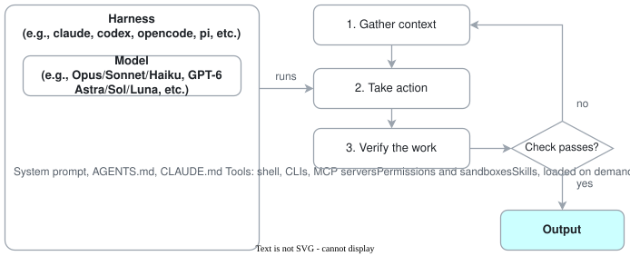
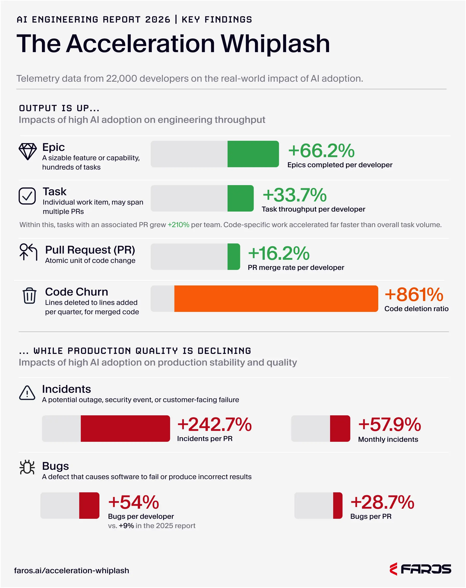
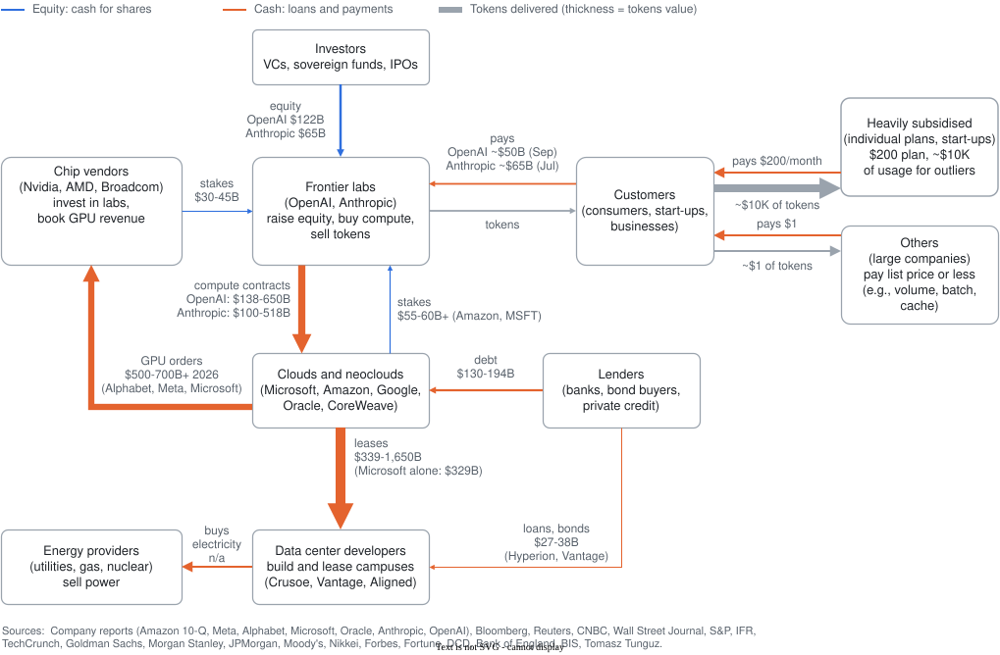
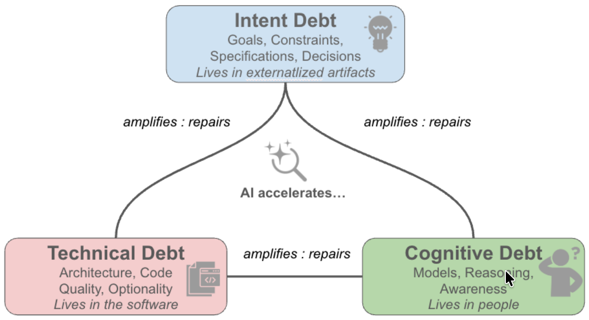

<!-- _paginate: false -->
<!-- _header: "" -->
<!-- _footer: "" -->
<!-- rumdl-disable MD013 -->
<!-- rumdl-disable MD033 -->

# Agentic Engineering

Marc Carré, October 2026

---

## Agenda

1. Status Quo
2. Curriculum

---

<!-- _class: divider -->

# 1. Status Quo

---

<!-- _class: content -->

## 1. Status Quo - Coding Agents

<div class="center">

**An agent is a _model_ inside a _harness_, looping until a _check_ passes**.



⚠️: Most failures are harness failures: missing context, missing tools, or no way to verify the work.

</div>

> **Sources**: [Addy Osmani: agent harness engineering](https://addyosmani.com/blog/agent-harness-engineering/) ; [Anthropic: building agents with the Claude Agent SDK](https://claude.com/blog/building-agents-with-the-claude-agent-sdk) ; [`pi`](https://pi.dev/) ; [`opencode`](https://opencode.ai/) ; [`codex`](https://github.com/openai/codex) ; [`claude`](https://x.com/shoucccc/status/2038894956459290963)

---

<!-- _class: content -->

## 1. Status Quo - Overall Trends

Adoption of AI agents is increasing. Tooling & practices are immature and changing quickly.

- From "_Vibe Coding_" to "_Agentic Engineering_".
- From "IDE auto-complete" to Agents in terminal, with parallel sessions, `git worktree`s, subagents, etc.
- From "_frustrated with ChatGPT_" to "_surprised by how 'good' `claude` is_".
- Still in transition & polarised: clean code → "_AI slop_", design docs → "_soup of words_", security risks, "_cognitive surrender_", burnout, etc.

| #   | Signal                                | Figure                                                                                          | Source                                                                                                                                               |
| --- | ------------------------------------- | ----------------------------------------------------------------------------------------------- | ---------------------------------------------------------------------------------------------------------------------------------------------------- |
| 1   | Engineers using AI at least 1h a day  | 80%                                                                                             | [Stack Overflow 2026 survey](https://survey.stackoverflow.co/2026/)                                                                                  |
| 2   | Engineers using AI agents             | 31% in 2025 → 59% in April 2026                                                                 | [Stack Overflow pulse survey](https://stackoverflow.blog/2026/09/30/getting-ready-for-2026-results-a-look-back-on-developer-survey-findings/)        |
| 3   | Trust AI output only when verifiable  | 48%                                                                                             | [Stack Overflow 2026 survey](https://survey.stackoverflow.co/2026/)                                                                                  |
| 4   | Claude Code market share              | 41% → 55%                                                                                       | [Stack Overflow pulse survey](https://stackoverflow.blog/2026/09/30/getting-ready-for-2026-results-a-look-back-on-developer-survey-findings/)        |
| 5   | Anthropic: work done _with_ AI        | 60%                                                                                             | [Anthropic 2026 Agentic Coding Trends Report](https://resources.anthropic.com/hubfs/2026%20Agentic%20Coding%20Trends%20Report.pdf)                   |
| 6   | Anthropic: work fully delegated to AI | 0~20%                                                                                           | [Anthropic 2026 Agentic Coding Trends Report](https://resources.anthropic.com/hubfs/2026%20Agentic%20Coding%20Trends%20Report.pdf)                   |
| 7   | Experienced OSS Engineers             | 19% slower in early 2025; <br /> 18% faster in late 2025 <br /> (⚠️ Unreliable / Low confidence) | [METR 2025](https://metr.org/blog/2025-07-10-early-2025-ai-experienced-os-dev-study/) ; [METR 2026](https://metr.org/blog/2026-02-24-uplift-update/) |

---

<!-- _class: content -->

## 1. Status Quo - Risk #1 - Quality Gap

<div class="columns-2-3">
  <div class="small-table">

_Writing_ code got faster, but _shipping_ it **reliably** did NOT.

| #   | Signal                           | Figure                                                                                                            | Source                                                                                    |
| --- | -------------------------------- | ----------------------------------------------------------------------------------------------------------------- | ----------------------------------------------------------------------------------------- |
| 1   | Writing v.s. Debugging           | 79% engineers write code faster (9.8h/week), but debugging & "unpicking" AI-generated code increased (16.9h/week) | [InfoQ: Undo survey](https://www.infoq.com/news/2026/10/survey-complex-codebases-agents/) |
| 2   | Understanding                    | 35% code shipped without understanding the change                                                                 | [InfoQ: Undo survey](https://www.infoq.com/news/2026/10/survey-complex-codebases-agents/) |
| 3   | Hallucinated root-cause analysis | 93% engineers saw at least one                                                                                    | [InfoQ: Undo survey](https://www.infoq.com/news/2026/10/survey-complex-codebases-agents/) |
| 4   | AI-co-authored PRs               | ~1.7x more issues <br /> (1.75x correctness; 1.64x quality; 1.57x security; 1.42x perf.)                          | [CodeRabbit]                                                                              |
| 5   | Downstream problems              | +861% churn, +442% review time, +243% incidents per PR                                                            | [Faros]                                                                                   |
| 6   | Output v.s. Productivity         | ~4x raw output, ~12% real productivity gains                                                                      | [GitClear]                                                                                |

- As of October 2026:
  - Models & harnesses are _not_ smart enough (yet).
  - Tooling & processes are lacking. Everyone is learning & re-adjusting.
- [DORA]: "**_AI is an amplifier_**". It magnifies existing strengths and dysfunctions.

  </div>
  <div>

[](https://www.faros.ai/blog/ai-acceleration-whiplash-takeaways)

</div>
</div>

> **Sources**: [InfoQ: Undo survey](https://www.infoq.com/news/2026/10/survey-complex-codebases-agents/) (Vendor-commissioned) ; [CodeRabbit] (Vendor) ; [DORA] ; [Faros] (Vendor) ; [GitClear] (Vendor) ; [Osmani](https://addyosmani.com/blog/agentic-code-review/) (ex-Google, Anthropic).

[CodeRabbit]: https://www.coderabbit.ai/content/assets/code-rabbit-state-of-ai-vs-human-code-generation-report-lite.pdf
[DORA]: https://cloud.google.com/blog/products/ai-machine-learning/introducing-doras-inaugural-ai-capabilities-model
[Faros]: https://www.faros.ai/blog/ai-acceleration-whiplash-takeaways
[GitClear]: https://gitclear-public.s3.us-west-2.amazonaws.com/Developer_Cohort_Analysis_AI_Coding_Output.pdf

---

<!-- _class: content -->

## 1. Status Quo - Risk #2 - Circular Bubble or Industrial Revolution?



---

<!-- _class: content -->

## 1. Status Quo - Risk #2 - Circular Bubble or Industrial Revolution? <!-- rumdl-disable-line no-duplicate-heading -->


<div class="popup1">

**A positive outcome requires**:

1. Smarter models.
2. Cheaper inference (e.g., [Taalas HC1], [demo][ChatJimmy]).
3. Robust tooling & processes.
4. Augmented human intelligence, NOT _[Cognitive Surrender]_.

</div>

[Taalas HC1]: https://taalas.com/the-path-to-ubiquitous-ai/
[ChatJimmy]: https://chatjimmy.ai/
[Cognitive Surrender]: https://addyosmani.com/blog/cognitive-surrender/

---

<!-- _class: content -->

## 1. Status Quo - Risk #3 - Cognitive Surrender & Debt - Problems

- **Cognitive Surrender**: Blindly adopting AI answers. (**73%** of AI users confidently accepted incorrect outputs.)

- **Decreased Comprehension**: AI users scored **17% lower** on comprehension (especially debugging) with zero time saved.

- In addition to **Technical Debt** ([Ward Cunningham, 1993][TechDebt]):
  - **Cognitive Debt**: Shared understanding erodes faster than it replenishes.
    This causes slow onboarding and burnout as AI's output is orders of
    magnitude above human code review abilities.
  - **Intent Debt**: Poorly documented system goals (requirements, ADRs, etc.)
    limit how effectively humans _and_ AI can evolve the codebase.

- **Engineering Anti-Patterns**:
  - Accepting large PRs just because tests pass.
  - Applying pasted stack-trace fixes without understanding the root cause(s).
  - Comprehension debt: Pushing code nobody on the team understands.
  - etc.

> **Sources**: [Shaw and Nave (SSRN)](https://papers.ssrn.com/sol3/papers.cfm?abstract_id=6097646) ; [Shen and Tamkin (arXiv 2601.20245)](https://arxiv.org/html/2601.20245v1) ; [Storey (arXiv:2603.22106)](https://arxiv.org/abs/2603.22106) ; [Addy Osmani][Cognitive Surrender]

[TechDebt]: https://martinfowler.com/bliki/TechnicalDebt.html

---

<!-- _class: content -->

## 1. Status Quo - Risk #3 - Cognitive Surrender & Debt - Solutions

- **Verify & Interrogate**:
  - Write down your expected answer **before** reading the AI agent's answer.
  - Ask the model to argue against its own answer.
- **Rigorous Review**:
  - Review an AI agent's PR as you would a junior engineer's PR (e.g., "tests pass" is not a review).
  - Request concrete evidence before accepting code (e.g., a trace, test run, or screenshot).
- **Scope & Skill Management**:
  - Keep changes small enough to comprehend ([~100 lines][GoogleStyleGuide]).
  - Code manually weekly to stay sharp.
  - Stop using AI when you're too tired to review.
- **Optimal AI Usage**:
  - Ask for explanations alongside code. Generate code then ask follow-up questions.
  - Use AI to accelerate learning, but write the code yourself.
  - ⚠️: For humans, mistakes are where learning typically happens.

[GoogleStyleGuide]: https://google.github.io/eng-practices/review/developer/small-cls.html#what-is-small

> **Sources**: [Addy Osmani][Cognitive Surrender] ; [Shen and Tamkin (arXiv 2601.20245)](https://arxiv.org/html/2601.20245v1) ; [Storey (arXiv:2603.22106)](https://arxiv.org/abs/2603.22106)

---

<!-- _class: content -->

## 1. Status Quo - Risk #4 - Security

| Risk Vector                                       | Current Threat Landscape & Examples                                                                                                                                                | Mitigation                                                                                                                                                     |
| :------------------------------------------------ | :--------------------------------------------------------------------------------------------------------------------------------------------------------------------------------- | :------------------------------------------------------------------------------------------------------------------------------------------------------------- |
| **[Prompt Injection]**                            | [The Lethal Trifecta] = Private Data + Untrusted Content + Egress                                                                                                                  | Never have all three. Use [sandboxes]. Use secrets brokers (e.g., [Automic Vault]).                                                                            |
| **[Sensitive Info Disclosure]**                   | AI leaking PII, credentials, or IP via outputs, logs, or APIs.                                                                                                                     | [Opt-out][ClaudePrivacy] of data training. Redact context (e.g., [Microsoft Presidio], [Guardrails AI]). Use secrets brokers.                                  |
| **[Supply Chain]**                                | Shai-Hulud [[1]][Shai-Hulud1][[2]][Shai-Hulud2] (500+ `npm` packages compromised) & ChainDrop [[3]][ChainDrop1][[4]][ChainDrop2] (400+ `npm` packages compromised in <4hrs).       | Pin dependencies. Maintain SBOMs. Sign code. Sign inventory. Limit egress. Use short-lived OIDC credentials.                                                   |
| **[Improper Output Handling]** <br />(incl. code) | AI writing code with vulnerabilities, hardcoded secrets, etc. Downstream tools or applications using unvalidated LLM output.                                                       | Use [`gitleaks`]. Use [SAST/DAST]. Use both LLM ([PurpleLlama CodeShield], [no-mistakes]) & HITL (Human-in-the-loop) reviews. Validate output against schemas. |
| **[Excessive Agency]**                            | AI granted broad permissions, leading to data loss or financial/reputational damage.                                                                                               | Enforce [Least Privilege] (PoLP). Require Human-in-the-Loop (HITL) for destructive/high-stakes actions.                                                        |
| **Agent Breakouts**                               | OpenAI/Hugging Face [[5]][OpenAI-Sec1][[6]][OpenAI-Sec2][[7]][OpenAI-Sec3] & Anthropic [[8]][Anthropic-Sec1][[9]][Anthropic-Sec2] evaluation breaches. Misconfigured environments. | Use [sandboxes] (ideally, OS-level). Do NOT rely on prompts.                                                                                                   |

See also: [OWASP](https://genai.owasp.org/resource/owasp-genai-llm-top-10-2026/) ; [Claude Docs about Security](https://code.claude.com/docs/en/security) ; [Agent Control Standard (ACS)](https://genai-security-project.github.io/agent-control-standard/)

[`gitleaks`]: https://github.com/gitleaks/gitleaks
[Anthropic-Sec1]: https://www.anthropic.com/news/investigating-incidents-cybersecurity-evals
[Anthropic-Sec2]: https://www.anthropic.com/news/improving-alignment-security-efforts
[Automic Vault]: https://github.com/automic-vault/automic-vault
[ChainDrop1]: https://www.veracode.com/blog/chaindrop-npm-supply-chain-worm/
[ChainDrop2]: https://www.suppliershield.com/post/chaindrop-npm-supply-chain-worm
[ClaudePrivacy]: https://privacy.claude.com/en/articles/12109829-how-do-i-change-my-model-improvement-privacy-settings
[Excessive Agency]: https://genai.owasp.org/llmrisk/llm08-excessive-agency/
[Guardrails AI]: https://github.com/guardrails-ai/guardrails
[Improper Output Handling]: https://genai.owasp.org/llmrisk/llm052025-improper-output-handling/
[Microsoft Presidio]: https://github.com/data-privacy-stack/presidio
[no-mistakes]: https://github.com/kunchenguid/no-mistakes
[OpenAI-Sec1]: https://openai.com/index/hugging-face-model-evaluation-security-incident/
[OpenAI-Sec2]: https://huggingface.co/blog/security-incident-july-2026
[OpenAI-Sec3]: https://openai.com/index/hugging-face-incident-and-the-road-ahead/
[Prompt Injection]: https://genai.owasp.org/llmrisk/llm01-prompt-injection/
[PurpleLlama CodeShield]: https://github.com/meta-llama/PurpleLlama/tree/main/CodeShield
[sandboxes]: https://code.claude.com/docs/en/sandbox-environments
[SAST/DAST]: https://community.owasp.org/Source_Code_Analysis_Tools
[Sensitive Info Disclosure]: https://genai.owasp.org/llmrisk/llm022025-sensitive-information-disclosure/
[Shai-Hulud1]: https://thenewstack.io/shai-hulud-pipeline-security/
[Shai-Hulud2]: https://unit42.paloaltonetworks.com/npm-supply-chain-attack/
[Supply Chain]: https://genai.owasp.org/llmrisk/llm03-training-data-poisoning/
[The Lethal Trifecta]: https://simonwillison.net/2025/Jun/16/the-lethal-trifecta/
[Least Privilege]: https://en.wikipedia.org/wiki/Principle_of_least_privilege

---

<!-- _class: divider -->

# 2. Curriculum <!-- rumdl-disable-line single-title -->

---

<!-- _class: content -->

## 2. Curriculum - Coding Agents <span style="color: grey">(Reminder)</span>

<div class="center">

**An agent is a _model_ inside a _harness_, looping until a _check_ passes**.


⚠️: Most failures are harness failures: missing context, missing tools, or no way to verify the work.

</div>

> **Sources**: [Addy Osmani: agent harness engineering](https://addyosmani.com/blog/agent-harness-engineering/) ; [Anthropic: building agents with the Claude Agent SDK](https://claude.com/blog/building-agents-with-the-claude-agent-sdk) ; [`pi`](https://pi.dev/) ; [`opencode`](https://opencode.ai/) ; [`codex`](https://github.com/openai/codex) ; [`claude`](https://x.com/shoucccc/status/2038894956459290963)

---

<!-- _class: content -->

## 2. Curriculum - Overview

<div class="stages">
  <div class="stage">
    <h5>1 - Foundations</h5>
    <p>One session. You drive.</p>
    <ul>
      <li><em>L0</em>First session</li>
      <li><em>L1</em>Memory & <code>CLAUDE.md</code></li>
      <li><em>L2</em>Plan, build, verify</li>
      <li><em>L3</em>Context & Sessions</li>
    </ul>
  </div>
  <div class="stage">
    <h5>2 - Harness</h5>
    <p>Improve the loop.</p>
    <ul>
      <li><em>L4</em>Permissions & Sandbox</li>
      <li><em>L5</em>Hooks & Gates</li>
      <li><em>L6</em>Skills & Plugins</li>
      <li><em>L7</em>CLIs & MCP servers</li>
      <li><em>L8</em>Subagents & Review</li>
    </ul>
  </div>
  <div class="stage">
    <h5>3 - Autonomy</h5>
    <p>Human-<b>on</b>-the-loop.</p>
    <ul>
      <li><em>L9</em>Goals & Loops</li>
      <li><em>L10</em>Headless & CI</li>
    </ul>
  </div>
  <div class="stage">
    <h5>4 - Parallel</h5>
    <p>Several agents. You supervise.</p>
    <ul>
      <li><em>L11</em>Git worktrees</li>
      <li><em>L12</em>Multi-agent terminal</li>
      <li><em>L13</em>Fan-out and overnight runs</li>
    </ul>
  </div>
  <div class="stage">
    <h5>5 - Economics</h5>
    <p>Tokens as a budget.</p>
    <ul>
      <li><em>L14</em>Measure spend</li>
      <li><em>L15</em>Cut tokens</li>
      <li><em>L16</em>Manage costs as a team</li>
    </ul>
  </div>
</div>

- Assumes `claude`, for simplicity.
- Action-oriented. Usable examples.
- 1 level = 1 slide = a few **commands** with comments + the **workflow** for that level.
- Each level builds on the previous ones.

---

<!-- _class: content -->
<!-- _header: 'Stage 1 - Foundations' -->

## 2. Curriculum - <span class="lv">L0</span>First session

Install Claude Code and learn the few keys that matter.

```bash
curl -fsSL https://claude.ai/install.sh | bash   # install (or: brew install --cask claude-code)
cd "${REPO_PATH}" && claude                      # start a session
```

```text
<Shift> + <Tab>  # inside Claude: switch modes (auto → manual → accept edits → plan)
<Esc> <Esc>      # rewind the code and/or the conversation to an earlier prompt
/clear           # start fresh before an unrelated task
```

<div class="tip pro">
  <b>💡 Pro tip</b>: Start with questions, e.g.,
  <i>"how is this class used?"</i>, or
  <i>"check the git history: why does this function take 15 arguments?"</i>.
  This speeds up onboarding too.
</div>

<div class="tip">
  <b>💰 Cost tip</b>: Each turn re-sends the whole conversation, so
  <a href="https://code.claude.com/docs/en/costs#manage-context-proactively"><code>/clear</code> between tasks</a>.
  Use <code>/model sonnet</code> for most tasks. (N.B.: <a href="https://code.claude.com/docs/en/costs#choose-the-right-model">default model</a> is Opus.)
</div>

<div class="flow">
  <b>Workflow</b>
  <span>Ask Claude to explain the code</span>
  <span>Make one small change</span>
  <span>Run it manually</span>
  <span>Review code</span>
  <span>Commit manually</span>
</div>

> **Sources**: [Setup](https://code.claude.com/docs/en/setup) ; [Interactive mode](https://code.claude.com/docs/en/interactive-mode) ; [Checkpointing](https://code.claude.com/docs/en/checkpointing) ; [Boris Cherny: Mastering Claude Code in 30 minutes](https://www.youtube.com/watch?v=6eBSHbLKuN0)

---

<!-- _class: content -->
<!-- _header: 'Stage 1 - Foundations' -->

## 2. Curriculum - <span class="lv">L1</span>Memory & `CLAUDE.md`

A global `CLAUDE.md` guides _all_ sessions. ([Example](https://github.com/marccarre/agentic-engineering/blob/main/AGENTS.md))
A project's `CLAUDE.md` guides that project's sessions. ([Example](https://github.com/marccarre/agentic-engineering/blob/main/python/AGENTS.md) for Python projects)

```text
/init         # initialise a new CLAUDE.md file with codebase documentation; ALWAYS prune/simplify it later.
/memory       # edit memory files; store personal notes in CLAUDE.local.md, git-ignored.
```

**Keep _only_ what Claude cannot _easily_ guess from the code**:

```markdown
## Design Principles

- No ORM: always use plain SQL for users management tables. (See: docs/adr/007-no-orm.md)
```

<div class="tip pro">
  <b>💡 Pro tip</b>:
  Commit a shared <code>CLAUDE.md</code> for the whole team to use the same rules.
  A <code>CLAUDE.md</code> in a subfolder loads only when working in that folder.
  Use <a href="https://github.com/kunchenguid/backpass"><code>backpass</code></a>.
</div>

<div class="tip">
  <b>💰 Cost tip</b>: <code>CLAUDE.md</code> loads on every turn:
  <b>keep it under 200 lines</b>.
  <a href="https://code.claude.com/docs/en/costs#move-instructions-from-claude-md-to-skills">Move specialised instructions into <i>skills</i></a>, which load only when needed.
</div>

<div class="flow">
  <b>Workflow</b>
  <span><i>Run <code>/init</code></i></span>
  <span>Delete what Claude can guess or already gets right</span>
  <span>Add a rule only when a real mistake could repeat</span>
  <span>Review changes to it like code</span>
</div>

> **Sources**: [Memory](https://code.claude.com/docs/en/memory) ; [Best practices](https://code.claude.com/docs/en/best-practices) ; [Addy Osmani: intent debt](https://addyosmani.com/blog/intent-debt/) ; [Boris Cherny: Mastering Claude Code in 30 minutes](https://www.youtube.com/watch?v=6eBSHbLKuN0) ; [Kun Chen: `backpass`](https://github.com/kunchenguid/backpass)

---

<!-- _class: content -->
<!-- _header: 'Stage 1 - Foundations' -->

## 2. Curriculum - <span class="lv">L2</span>Plan, build, verify

Plan before code, give Claude a check it can run, and ask for evidence.

```text
<Shift> + <Tab>  # into plan mode: Claude explores and proposes, no edits yet
<Ctrl> + <G>     # edit the plan in your own editor before you approve it
/clear           # after two failed corrections, start over with a better prompt
```

**Write a prompt that tells Claude how to check its work**:

```text
users report login fails after a session timeout: <stacktrace>
check src/auth/, write a failing test that reproduces it, then fix it and show me the test output.
```

<div class="tip pro">
  <b>💡 Pro tip</b>: Give Claude a way to check itself: linter, tests, screenshots, etc.
  Use <code>/goal</code>.
  Paste in a mock for Claude to converge faster. Use <a href="https://github.com/kunchenguid/lavish-axi"><code>lavish</code></a>.
</div>

<div class="tip">
  <b>💰 Cost tip</b>:
  <a href="https://code.claude.com/docs/en/costs#write-specific-prompts">Name the file and function</a> so Claude reads less.
  <a href="https://code.claude.com/docs/en/costs#work-efficiently-on-complex-tasks">
    Stop early when going in the wrong direction <code>&lt;Esc&gt;</code> or <code>/rewind</code>
  </a>: rework is the most expensive output.
</div>

<div class="flow">
  <b>Workflow</b>
  <span>Explore in plan mode</span>
  <span>Agree on a plan with checks at the end</span>
  <span>Agent: add failing test(s) first</span>
  <span>Agent: build</span>
  <span>Review code</span>
</div>

> **Sources**: [Best practices](https://code.claude.com/docs/en/best-practices) ; [Permission modes: plan mode](https://code.claude.com/docs/en/permission-modes) ; [Boris Cherny: Mastering Claude Code in 30 minutes](https://www.youtube.com/watch?v=6eBSHbLKuN0) ; [Kun Chen: `lavish`](https://github.com/kunchenguid/lavish-axi)

---

<!-- _class: content -->
<!-- _header: 'Stage 1 - Foundations' -->

## 2. Curriculum - <span class="lv">L3</span>Context & Sessions

Keep the context window small, and every session easy to resume.

```text
/context                           # check what fills the context window
/compact keep the plan and tests   # summarise, keeping what you specify
/rename auth-fix                   # name the session before you /clear ...
/resume                            # ... so you can come back to it later
/btw <question>                    # a side question that stays out of the history and context
```

<div class="tip">
  <b>💰 Cost tip</b>:
  <a href="https://code.claude.com/docs/en/prompt-caching#compacting-the-conversation"><code>/compact</code> rebuilds the prompt cache</a>: do it between related tasks, not mid-task.
  To backtrack from a dead-end, run <a href="https://code.claude.com/docs/en/prompt-caching#rewinding-the-conversation"><code>/rewind</code>: it reverts the cache too</a>.
</div>

<div class="flow">
  <b>Workflow</b>
  <span>One task per session</span>
  <span>Watch the context %</span>
  <span><i><code>/compact</code> or <code>/clear</code><br/>at 60-80% context usage</i></span>
  <span>Keep state in files and git</span>
</div>

> **Sources**: [Costs](https://code.claude.com/docs/en/costs) ; [Context window](https://code.claude.com/docs/en/context-window) ; [Checkpointing](https://code.claude.com/docs/en/checkpointing)

---

<!-- _class: content -->
<!-- _header: 'Stage 2 - Harness' -->

## 2. Curriculum - <span class="lv">L4</span>Permissions & Sandbox

Configure what Claude can/cannot do, instead of approving it click by click.

Do so in **`.claude/settings.json`, committed, for the whole team to use the same configuration.**

```json
{
  "permissions": {
    "allow": ["Bash(uv run pytest*)", "Bash(git commit *)"],
    "ask":   ["Bash(git push *)"],
    "deny":  ["Read(./.env)", "Read(./.envrc)", "Read(./secrets/**)"]
  }
}
```

```text
/sandbox      # isolate shell commands: files and network (macOS, Linux, WSL2)
```

<div class="tip pro">
  <b>💡 Pro tip</b>: Configure organisation-wide rules in
  <a href="https://code.claude.com/docs/en/settings">managed settings</a>. E.g., <b>allow</b> reading RFCs/ADRs, <b>deny</b> unsafe/sensitive resources.
  Users cannot override these rules.
</div>

<div class="flow">
  <b>Workflow</b>
  <span>Note the prompts you approve</span>
  <span><i>Safe & frequent: <code>allow</code>; risky: <code>ask</code>; secrets: <code>deny</code></i></span>
  <span>Commit the file</span>
  <span><i>Turn on <code>/sandbox</code></i></span>
</div>

> **Sources**: [Permissions](https://code.claude.com/docs/en/permissions) ; [Sandboxing](https://code.claude.com/docs/en/sandboxing) ; [Boris Cherny: Mastering Claude Code in 30 minutes](https://www.youtube.com/watch?v=6eBSHbLKuN0)

---

<!-- _class: content -->
<!-- _header: 'Stage 2 - Harness' -->

## 2. Curriculum - <span class="lv">L5</span>Hooks & Gates

<style scoped>
  .tip { margin-top: 0px; margin-bottom: 0px; }
  .flow { margin-top: 5px; }
</style>

For rules to always follow (e.g., "_format every edit_", "_check every commit_", etc.):

- **add `hooks` in `.claude/settings.json`**
- **add `git` pre-commit hooks** to enforce it for _both_ AI and humans, e.g., with [`prek`].

```json
{ "hooks": {
    "PostToolUse": [{
      "matcher": "Edit|Write",
      "hooks": [{
        "type": "command",
        "command": "jq -r '.tool_input.file_path' | xargs uv run ruff format"
      }]
    }]
}}
```

```bash
uv tool install prek && prek install   # format, lint, type-check and test before every commit
```

<div class="tip">
  <b>💰 Cost tip</b>:
  <a href="https://code.claude.com/docs/en/costs#offload-processing-to-hooks-and-skills">Filter test output with a hook</a> and keep only the <code>FAIL</code> and <code>ERROR</code> lines, so the full log never enters the
  context.
</div>

<div class="flow">
  <b>Workflow</b>
  <span>Claude repeats a mistake</span>
  <span>Can a tool catch it?</span>
  <span>Add a hook, lint rule, <br/>and CI check</span>
  <span><i>Review logic and tests, <br/><u>not</u> style</i></span>
</div>

> **Sources**: [Hooks guide](https://code.claude.com/docs/en/hooks-guide) ; [`prek`]

[`prek`]: https://github.com/j178/prek

---

<!-- _class: content -->
<!-- _header: 'Stage 2 - Harness' -->

## 2. Curriculum - <span class="lv">L6</span>Skills & Plugins

<style scoped>
  .tip { margin-top: 0px; margin-bottom: 5px; }
  .flow { margin-top: 5px; }
</style>

Turn a prompt you keep retyping into a slash command, e.g.:

```console
$ cat .claude/skills/fix-issue/SKILL.md

---
name: fix-issue
description: Fix a GitHub issue end to end, given its number.
disable-model-invocation: true
---
Fix issue $ARGUMENTS: reproduce it with a failing test, fix it, show the test output.
```

```text
/fix-issue 1234                                                  # inside Claude: run your skill

claude plugin install mattpocock-skills@claude-plugins-official  # or install a proven pack (warning: security risk! 🔐)
claude plugin install agent-skills@addy-agent-skills
```

<div class="tip pro">
  <b>💡 Pro tip</b>: Avoid mass-installing skills: they bloat context and degrade performance (<a href="https://arxiv.org/abs/2602.20867">arXiv:2602.20867</a> ; <a href="https://arxiv.org/abs/2608.11888">arXiv:2608.11888</a>). Build your own with <a href="https://github.com/anthropics/claude-plugins-official/blob/main/plugins/skill-creator/skills/skill-creator/SKILL.md"><code>/skill-creator</code></a>.
</div>

<div class="tip">
  <b>💰 Cost tip</b>: For typed and type-annotated languages,
  <a href="https://code.claude.com/docs/en/costs#install-code-intelligence-plugins-for-typed-languages">
  install a code intelligence (LSP) plugin</a>:
  Claude jumps to definitions instead of reading and searching files.
</div>

<div class="flow">
  <b>Workflow</b>
  <span>Typed it several times?</span>
  <span>Make it a skill</span>
  <span>Test it in a fresh session</span>
  <span>Delete skills that overlap</span>
</div>

> **Sources**: [Skills](https://code.claude.com/docs/en/skills) ; [mattpocock/skills](https://github.com/mattpocock/skills) ; [addyosmani/agent-skills](https://github.com/addyosmani/agent-skills) ; [Code Intelligence](https://code.claude.com/docs/en/plugins/code-intelligence) ; [Skill Creator](https://github.com/anthropics/claude-plugins-official/blob/main/plugins/skill-creator/skills/skill-creator/SKILL.md) ; [SkillsBench](https://www.skillsbench.ai/blogs/introducing-skillsbench) ; [Skills invocation benchmark](https://x.com/kunchenguid/status/2044240037483819220)

---

<!-- _class: content -->
<!-- _header: 'Stage 2 - Harness' -->

## 2. Curriculum - <span class="lv">L7</span>CLIs & MCP servers

Connect the systems you work in, with as few tools as possible.

```bash
gh auth login                                                      # CLIs first: no context cost

claude mcp add --transport http notion https://mcp.notion.com/mcp  # add a server
claude mcp list                                                    # check that it connects
```

```text
/mcp          # inside Claude: disable the servers you don't use
```

<div class="tip pro">
  <b>💡 Pro tip</b>: Tell Claude to run <code>&lt;your-cli&gt; --help</code> to
  learn about CLI tools, then note it in <code>CLAUDE.md</code>. Commit
  <code>.mcp.json</code> so the whole team gets the same servers.
</div>

<div class="tip">
  <b>💰 Cost tip</b>: Prefer CLIs to MCP servers. CLIs use less context:
  MCP servers load their tool definitions into every session.
</div>

<div class="flow">
  <b>Workflow</b>
  <span>Use a CLI if one exists</span>
  <span>Add MCP if no CLI exists</span>
  <span><i>Compare <code>/context</code> before and after</i></span>
  <span>Prefer read-only permissions</span>
</div>

> **Sources**: [MCP](https://code.claude.com/docs/en/mcp) ; [Costs](https://code.claude.com/docs/en/costs) ; [Model Context Protocol](https://modelcontextprotocol.io/) ; [Anthropic: Code execution with MCP](https://www.anthropic.com/engineering/code-execution-with-mcp) ; [AXI](https://axi.md/) ; [Kun Chen: GitHub CLI vs MCP vs tool search vs code mode](https://kunchenguid.medium.com/i-benchmarked-github-cli-vs-mcp-vs-tool-search-vs-code-mode-turns-out-the-best-solution-is-none-93528d5039e4)

---

<!-- _class: content -->
<!-- _header: 'Stage 2 - Harness' -->

## 2. Curriculum - <span class="lv">L8</span>Subagents & Review

Never let the writer be the judge: review in a fresh context.

```text
/code-review        # review your branch in a fresh context, in the background
/security-review    # a security pass against the default branch
/simplify           # cleanup only: reuse, simplification, efficiency

use a subagent to run the tests and report only the failures   # keeps noise out
```

<div class="tip">
  <b>💰 Cost tip</b>:
  <a href="https://code.claude.com/docs/en/sub-agents#choose-a-model">Set <code>model: haiku</code> on subagents</a>
  that run tests or read logs:
  <a href="https://code.claude.com/docs/en/costs#delegate-verbose-operations-to-subagents">only their summary comes back</a>
  to the main context.
</div>

<div class="tip pro">
  <b>💡 Pro tip</b>: Run CI locally with
  <a href="https://github.com/nektos/act"><code>act</code></a>. Run <a href="https://kunchenguid.github.io/no-mistakes/"><code>git push no-mistakes</code></a>:
  an agentic pipeline reviews, lints, and tests in a disposable worktree, then opens the PR.
</div>

<div class="flow">
  <b>Workflow</b>
  <span>Claude writes the change</span>
  <span>Claude reviews its output in a fresh context</span>
  <span>You triage every finding</span>
  <span>You write the PR summary</span>
</div>

> **Sources**: [Code review](https://code.claude.com/docs/en/code-review) ; [Subagents](https://code.claude.com/docs/en/sub-agents) ; [Addy Osmani: agentic code review](https://addyosmani.com/blog/agentic-code-review/) ; [claude-code-security-review](https://github.com/anthropics/claude-code-security-review) ; [no-mistakes](https://kunchenguid.github.io/no-mistakes/)

---

<!-- _class: content -->
<!-- _header: 'Stage 3 - Autonomy' -->

## 2. Curriculum - <span class="lv">L9</span>Goals & Loops

Let Claude keep working until a _measurable_ condition becomes true.

```text
# work until the condition holds; a separate model checks it after every turn
/goal all tests in test/auth pass; no other test file changes; stop after 20 turns

# repeat a prompt on a schedule
/loop 5m check if the deployment finished and tell me what happened
```

```bash
claude --permission-mode auto   # no prompt per step (the default since v2.1.283)
```

<div class="tip">
  <b>💰 Cost tip</b>: Always cap the turns.
  <a href="https://code.claude.com/docs/en/costs#why-usage-climbs-in-a-long-session">Stop idle <code>/loop</code> and scheduled tasks</a>: each run re-sends the whole context.
</div>

<div class="flow">
  <b>Workflow</b>
  <span>Write a measurable "done" condition</span>
  <span>Run in auto mode with the sandbox</span>
  <span>Come back to evidence</span>
  <span>Review & Merge</span>
</div>

> **Sources**: [Goal](https://code.claude.com/docs/en/goal) ; [Scheduled tasks](https://code.claude.com/docs/en/scheduled-tasks) ; [Addy Osmani: practical loop engineering](https://addyosmani.com/blog/practical-loop-engineering/)

---

<!-- _class: content -->
<!-- _header: 'Stage 3 - Autonomy' -->

## 2. Curriculum - <span class="lv">L10</span>Headless & CI

Run Claude from scripts and pipelines, with exact permissions and budgets.

```bash
claude -p "summarise this branch" --output-format json | jq -r .result            # one-shot, scriptable

claude -p "fix the failing test in auth.test.ts" \
  --permission-mode dontAsk \
  --allowedTools "Read,Edit,Bash(npm test *)" --max-turns 10 --max-budget-usd 2   # permissions and costs capped
```

```text
/install-github-app   # inside Claude: answer @claude in GitHub issues and PRs
```

<div class="tip pro">
  <b>💡 Pro tip</b>: Pipe into <code>claude -p</code> like any Unix tool, e.g.,
  <code>cat app.log | claude -p "what is unusual here?"</code>. Anthropic uses it in CI and incident response.
</div>

<div class="tip">
  <b>💰 Cost tip</b>: Use the cheapest model that passes your checks in each job,
  e.g. <code>--model sonnet</code>.
  <a href="https://code.claude.com/docs/en/costs#choose-the-right-model">Keep Opus for the hard problems</a>.
</div>

<div class="flow">
  <b>Workflow</b>
  <span>Prototype the prompt interactively</span>
  <span>Configure tools. Cap permissions & costs.</span>
  <span>Pilot on 2–3 inputs</span>
  <span>Use in scripts and CI</span>
  <span>Human approval gate</span>
</div>

> **Sources**: [Headless](https://code.claude.com/docs/en/headless) ; [GitHub Actions](https://code.claude.com/docs/en/github-actions) ; [Boris Cherny: Mastering Claude Code in 30 minutes](https://www.youtube.com/watch?v=6eBSHbLKuN0)

---

<!-- _class: content -->
<!-- _header: 'Stage 4 - Parallel' -->

## 2. Curriculum - <span class="lv">L11</span>Git worktrees

One task, one branch, one worktree: sessions never collide.

```bash
echo '.claude/worktrees/' >> .gitignore   # keep worktrees out of git
printf '.env\n' > .worktreeinclude        # gitignored files to copy into each worktree

claude -w feat-foobar                     # a session in its own worktree and branch
git worktree list                         # list all worktrees; remove merged ones
```

<div class="tip pro">
  <b>💡 Pro tip</b>: <a href="https://github.com/kunchenguid/treehouse"><code>treehouse</code></a>
  keeps a pool of reusable worktrees, so each agent starts fast with dependencies and build cache intact.
</div>

<div class="flow">
  <b>Workflow</b>
  <span>Split work into tasks</span>
  <span>One worktree and PR per task</span>
  <span>Review & merge each PR</span>
  <span>Remove merged worktrees</span>
</div>

> **Sources**: [Worktrees](https://code.claude.com/docs/en/worktrees) ; [`git worktree`](https://git-scm.com/docs/git-worktree) ; [`treehouse`](https://github.com/kunchenguid/treehouse)

---

<!-- _class: content -->
<!-- _header: 'Stage 4 - Parallel' -->

## 2. Curriculum - <span class="lv">L12</span>Multi-agent terminal

Watch three or four agents at once, and see which one needs you.

```bash
# herdr: a terminal multiplexer that shows which agent is blocked
curl -fsSL https://herdr.dev/install.sh | sh && herdr integration install claude

# cmux on macOS: native panes and agent notifications; pair it with claude -w
brew tap manaflow-ai/cmux && brew install --cask cmux

# or good ol' tmux: one Claude per pane, each in its own worktree
tmux new-session -d -s agents 'claude -w a1' \; split-window 'claude -w a2' \; attach
```

<div class="tip pro">
  <b>💡 Pro tip</b>: <a href="https://github.com/kunchenguid/firstmate"><code>firstmate</code></a>:
  talk to one agent, and it runs a crew of agents in their own worktrees and returns finished PRs.
</div>

<div class="tip">
  <b>💰 Cost tip</b>: Track each agent's spend:
  <a href="https://code.claude.com/docs/en/statusline#use-the-%2Fstatusline-command"><code>/statusline show context percentage with a progress bar, session cost, and duration</code></a>.
</div>

<div class="flow">
  <b>Workflow</b>
  <span>Start with two agents</span>
  <span>Give each agent a task and "done" condition</span>
  <span>Unblock waiting agents</span>
  <span>Review one PR at a time</span>
</div>

> **Sources**: [`herdr` docs](https://herdr.dev/docs/) ; [`cmux` docs](https://cmux.com/docs) ; [Addy Osmani: your parallel agent limit](https://addyosmani.com/blog/cognitive-parallel-agents/) ; [`firstmate`](https://github.com/kunchenguid/firstmate) ; [Kun Chen: `firstmate` note](https://substack.com/@kunchenguid/note/c-311919739)

---

<!-- _class: content -->
<!-- _header: 'Stage 4 - Parallel' -->

## 2. Curriculum - <span class="lv">L13</span>Fan-out and overnight runs

Hand over large work that splits cleanly, and let a pipeline review it first.

```text
/batch migrate @src from Python to Rust          # 5–30 units, one worktree each
```

```bash
no-mistakes init && git push no-mistakes         # review, lint and test, then open PR

npm install -g gnhf                              # overnight loop: commits on success, rolls back on failure
gnhf "reduce complexity without changing behaviour" --max-iterations 10 --max-tokens 5000000
```

<div class="tip">
  <b>💰 Cost tip</b>: Fan-out multiplies tokens:
  <a href="https://code.claude.com/docs/en/costs#agent-team-token-costs">agent teams use about 7x the tokens</a>, and
  <a href="https://code.claude.com/docs/en/workflows">dynamic workflows</a> use
  many too. Keep agent teams small. Set token caps.
</div>

<div class="flow">
  <b>Workflow</b>
  <span>Check the plan before proceeding</span>
  <span>Pilot 2-3 units</span>
  <span>Let the pipeline review first</span>
  <span>Review risky changes <br/>+ a sample of the rest</span>
</div>

> **Sources**: [Commands: /batch](https://code.claude.com/docs/en/commands) ; [`gnhf`](https://github.com/kunchenguid/gnhf) ; [`no-mistakes`](https://github.com/kunchenguid/no-mistakes)

---

<!-- _class: content -->
<!-- _header: 'Stage 5 - Economics' -->

## 2. Curriculum - <span class="lv">L14</span>Measure spend

Know what each session, task and pull request costs.

```text
/usage                                  # inside Claude: this session's cost, cache hits and misses
```

```bash
npx ccusage@latest claude daily                                 # cost per day, from local logs

npx -y ccstatusline@latest                                      # cost and context % in your status line

claude -p "<task>" --output-format json | jq .total_cost_usd    # cost of scripted runs
```

<div class="tip pro">
  <b>💡 Pro tip</b>:
  <a href="https://code.claude.com/docs/en/prompt-caching#actions-that-invalidate-the-cache">Actions that invalidate the cache</a>:
  switch model, change effort, add/remove MCP server, add/remove plugin, <code>/compact</code>, upgrade Claude Code.
</div>

<div class="tip">
  <b>💰 Cost tip</b>: The status line cost is
  <a href="https://code.claude.com/docs/en/statusline#available-data">an estimate at list price, and resets on <code>/clear</code></a>. Show the
  <a href="https://code.claude.com/docs/en/statusline#prompt-cache-fields">cache hit rate (<code>prompt_cache.hit_ratio</code>)</a>.
</div>

<div class="flow">
  <b>Workflow</b>
  <span>Watch the status line</span>
  <span><i>Check <code>ccusage</code> weekly</i></span>
  <span>Track cost per merged PR</span>
  <span>Review expensive outliers</span>
  <span>Improve practices & process</span>
</div>

> **Sources**: [Costs](https://code.claude.com/docs/en/costs) ; [Prompt caching](https://code.claude.com/docs/en/prompt-caching) ; [`ccusage`](https://ccusage.com) ; [`ccstatusline`](https://github.com/sirmalloc/ccstatusline)

---

<!-- _class: content -->
<!-- _header: 'Stage 5 - Economics' -->

## 2. Curriculum - <span class="lv">L15</span>Cut tokens

Use the cheapest model, lowest effort, simplest setup that succeeds.
Only use better model, higher effort, etc. when it fails.

```text
/model sonnet     # choose the model per task, at the start of the task
/effort low       # lower effort first: it keeps the prompt cache
/clear            # clear between tasks: the whole history is re-sent every turn
```

```bash
export CLAUDE_CODE_SUBAGENT_MODEL=haiku   # cheaper subagents

brew install rtk && rtk init -g           # compact shell output; measure before and after
```

<div class="tip pro">
  <b>💡 Pro tips</b>: Cut tokens in/out.
  <b>In</b>: <a href="https://github.com/rtk-ai/rtk"><code>rtk</code></a> compacts shell output; <a href="https://github.com/headroomlabs-ai/headroom"><code>headroom</code></a> compresses tool output, logs, and files.
  <b>Out</b>: <a href="https://github.com/juliusbrussee/caveman"><code>caveman</code></a> shortens replies.
</div>

<div class="tip">
  <b>💰 Cost tip</b>:
  <a href="https://code.claude.com/docs/en/prompt-caching#switching-models">A model switch re-reads the whole history</a>
  (<code>opusplan</code> switches at each plan toggle). Use Sonnet with
  <a href="https://code.claude.com/docs/en/advisor"><code>/advisor opus</code></a>.
  <a href="https://code.claude.com/docs/en/fast-mode#understand-the-cost-tradeoff">Avoid fast mode</a>: 2x Opus costs.
</div>

<div class="flow">
  <b>Workflow</b>
  <span>Measure a baseline</span>
  <span><i>Trim <code>CLAUDE.md</code>, MCP servers, skills, etc.</i></span>
  <span>Use cheaper model, low effort, cheaper subagents</span>
  <span>Measure again. Keep what helps. Repeat</span>
</div>

> **Sources**: [Costs](https://code.claude.com/docs/en/costs) ; [Model configuration](https://code.claude.com/docs/en/model-config) ; [`rtk`](https://github.com/rtk-ai/rtk) ; [`headroom`](https://github.com/headroomlabs-ai/headroom) ; [`caveman`](https://github.com/juliusbrussee/caveman) ; [Tejas Chopra (Netflix): Headroom](https://www.youtube.com/watch?v=UOWSHg18cL0)

---

<!-- _class: content -->
<!-- _header: 'Stage 5 - Economics' -->

## 2. Curriculum - <span class="lv">L16</span>Manage costs as a team

Dashboards and budgets for the whole team (not tried yet!):

```bash
git clone https://github.com/anthropics/claude-code-monitoring-guide
cd claude-code-monitoring-guide && docker-compose up -d                   # collector, Prometheus, Grafana :3000

# send each session's metrics to the collector (for a team, put these in managed settings)
export CLAUDE_CODE_ENABLE_TELEMETRY=1 \
       OTEL_METRICS_EXPORTER=otlp \
       OTEL_EXPORTER_OTLP_PROTOCOL=grpc \
       OTEL_EXPORTER_OTLP_ENDPOINT=http://localhost:4317
```

<div class="tip">
  <b>💰 Cost tip</b>: Push a cheaper default (<code>"model": "sonnet"</code>),
  <a href="https://code.claude.com/docs/en/model-config#restrict-model-selection"><code>availableModels</code></a>
  and
  <a href="https://code.claude.com/docs/en/costs#claude-for-teams-and-enterprise">spend limits</a>
  to everyone through managed settings.
</div>

<div class="flow">
  <b>Workflow</b>
  <span>Create a pilot</span>
  <span>Add telemetry to managed settings</span>
  <span>Set budgets as guardrails</span>
  <span>Review cost per merged PR monthly</span>
</div>

> **Sources**: [Monitoring](https://code.claude.com/docs/en/monitoring-usage) ; [Monitoring guide](https://github.com/anthropics/claude-code-monitoring-guide)

---

<!-- _class: content -->

## 2. Curriculum - Mindset

Working with AI Agents may require a _mindset shift_:

- We _all_ become Engineering Managers of "_brilliant interns_". (No offense to interns. 🙏 No offense to AI. 🙏 No offense to managers. 🙏)
- As (Traditional _and_ Agentic) Engineering Managers, we need to:
  - improve the **practices** for our "teams" to perform well,
  - remove **bottlenecks** in the current process and continuously improve it.
- The same practices that make great engineering teams _also_ apply to agentic engineering teams:
  - RFCs, ADRs, etc. to capture technical **decisions** and the **context** around them,
  - CICD, tests, linting, type checking, pre-commit hooks, etc. -- for **short feedback loops**.

|                   | Software Engineering          | Engineering Management        | Agentic Engineering                                |
| ----------------- | ----------------------------- | ----------------------------- | -------------------------------------------------- |
| **Language**      | Programming language (formal) | Natural language (ambiguous)  | Natural language (ambiguous)                       |
| **Behaviour**     | Deterministic                 | Non-deterministic             | Non-deterministic                                  |
| **Input**         | Requirements, context         | Vision, requirements, context | Requirements and context, written for agents       |
| **Quality check** | Tests                         | Clear goals                   | Verifiable goals: tests, checks                    |
| **Review**        | Code review                   | Product review, QA            | Code, plans and evidence; a human owns every merge |
| **Process**       | Low-level (BDD, TDD)          | High-level (SDLC)             | High-level (SDLC); agents run TDD                  |

---

<!-- _class: content -->

## Next steps

1. Try and master each step
2. Share learned lessons
3. Consolidate practices
4. Accelerate _without_ sacrificing understanding & quality
5. Measure team costs and performance (DORA metrics)

<div class="center" style="margin-top: auto; margin-bottom: 150px">

**Recommendations**:

_Start small. Measure. Improve._
_Keep using your brain._
_Keep quality high._
_Keep a human on every merge (at least for now)._

</div>

---

<!-- _class: divider -->
<!-- _paginate: false -->
<!-- _header: "" -->
<!-- _footer: "" -->

<div class="center">

# Thank you! 🙏

Questions?

</div>
